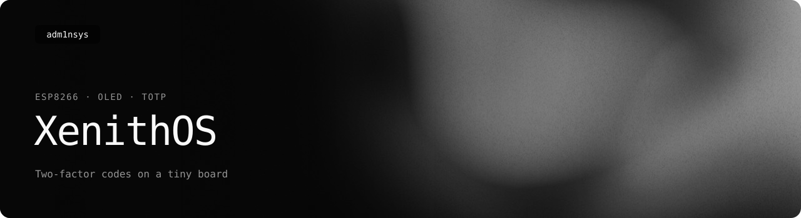
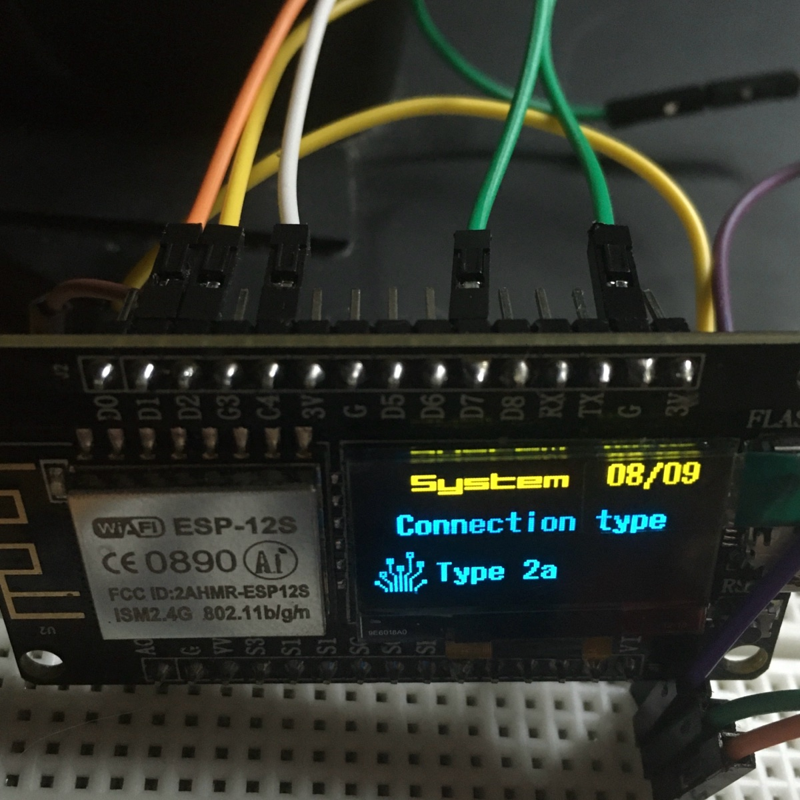
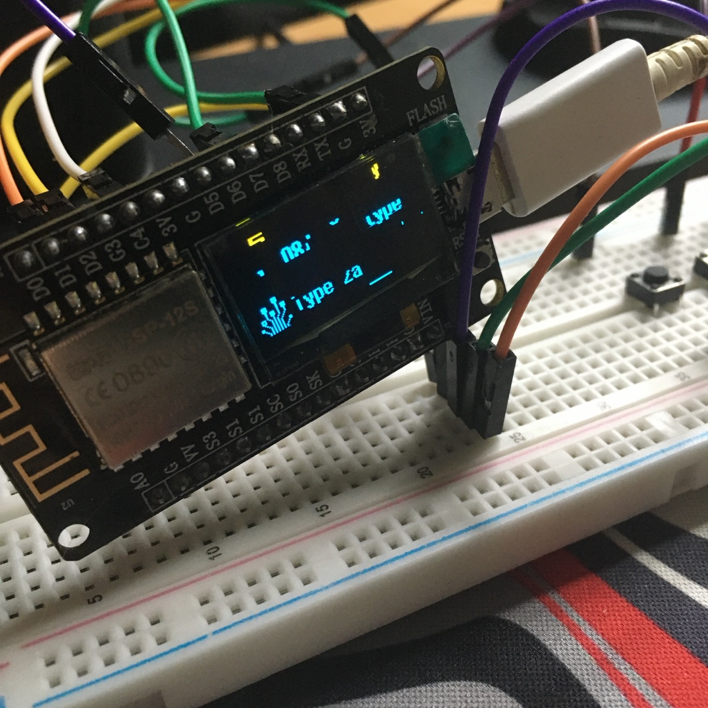

<picture>
  <source media="(prefers-color-scheme: light)" srcset=".github/readme/banner-light.svg">
  
</picture>

<p>
  <a href="https://adm1nsys.github.io/XenithOS/"></a>
  <a href="https://github.com/adm1nsys/XenithOS/archive/refs/heads/main.zip"></a>
  <a href="https://adm1nsys.github.io/XenithOS/#versions"></a>
  
  <a href="LICENSE"></a>
</p>

A two-factor code generator (TOTP) on an ESP8266 board with a built-in 0.96" OLED — the six-digit codes an authenticator app shows, on a small device with its own buttons, menu and status bar.



## What it does

- **TOTP codes** for as many accounts as fit into memory, each with its own name in the menu, and a countdown until the code changes
- **Time over the network**: connects to the first available of several Wi-Fi networks and syncs the clock over NTP — TOTP only works with the exact time
- **Status bar** with a warning icon when Wi-Fi or the time sync fails
- **Apps** in the same menu: *Diagnostic* (re-checks Wi-Fi and time), *System* (version, board, wiring), *Reboot*, *NO WAR* (links to Ukrainian aid funds)
- **Sleep** — the screen turns off on a button press and wakes on the next
- A boot screen with progress, and a menu that is easy to extend with new apps

## Hardware

The ESP8266 development board with a 0.96" SSD1306 OLED (sold as "ideaspark" and under other names; ESP-12 module, Micro USB). Its pinout differs from a regular NodeMCU — the display sits on GPIO 12 (SDA) and GPIO 14 (SCL).

Four push buttons, each between a pin and GND (the internal pull-ups are used, no resistors needed):

| Pin (board label) | Button |
|---|---|
| D1 | up in the menu / previous page |
| D2 | down in the menu / next page |
| C4 (D4) | home |
| D7 | open / apply |
| FLASH (on the board) or G3 (D3) | sleep / wake up |

I avoided D0, D5, D6 and D8: on my board buttons on them made the input unstable and left artifacts on the screen:



## Build and flash

1. Install the [Arduino IDE](https://www.arduino.cc/en/software) and add the ESP8266 core: *Settings → Additional boards manager URLs* → `https://arduino.esp8266.com/stable/package_esp8266com_index.json`, then install **esp8266** in the Boards Manager.
2. Install the libraries: **U8g2**, **NTPClient**, **Time**, **TOTP library** (Luca Dentella) and **Base32-Decode**.
3. Open [`firmware/XenithOS/XenithOS.ino`](firmware/XenithOS/XenithOS.ino), choose the board **NodeMCU 1.0 (ESP-12E Module)** and the port, upload.

With the command line instead:

```bash
arduino-cli core install esp8266:esp8266 --additional-urls https://arduino.esp8266.com/stable/package_esp8266com_index.json
arduino-cli lib install U8g2 NTPClient Time "TOTP library" Base32-Decode
arduino-cli compile --upload -p /dev/ttyUSB0 --fqbn esp8266:esp8266:nodemcuv2 firmware/XenithOS
```

## Configuration

Everything is set in the sketch before flashing; the instructions are also in the comment block at the top of the file.

```cpp
// Wi-Fi networks — the first one that answers is used
{"Network1", "Password1"},
{"Network2", "Password2"},

// accounts: name in the menu, Base32 secret without spaces
{"GitHub", "JBSWY3DPEHPK3PXP"},
{"Mail",   "KRSXG5CTMVRXEZLU"},
```

- The secret is the text code a service shows next to the QR code when you set up two-factor login ("X00X 00XX 0XXX …") — remove the spaces. Up to 32 characters (160 bits, the usual length).
- The NTP server is `pool.ntp.org`; a second one is prepared as a comment.
- New apps: add `{"Name", FunctionView}` to `additionalMenuItems` and write the function.

## Security

This is a learning project, not a hardware security key:

- The secrets are compiled into the firmware in plain text. Anyone who gets the board can read the flash over USB and copy every account. Keep backup codes and a second factor elsewhere.
- No PIN, no encryption, no secure element. FIDO2 / U2F / WebAuthn are not supported.
- The board has no real-time clock: without Wi-Fi after a restart there is no time, so no valid codes.

## Versions

| Version | Date | Changes |
|---|---|---|
| [Beta 2 RC](firmware/XenithOS/XenithOS.ino) | 18 May 2024 | several accounts and Wi-Fi networks, apps (Diagnostic, System, Reboot), sleep, status bar at the top, four-button wiring |
| [Beta 1](firmware/beta-1/XenithOS/XenithOS.ino) | 5 May 2024 | one account, two buttons + FLASH, time synced manually |

## License

[GPL-3.0](LICENSE) © Heorhii Romanenko
